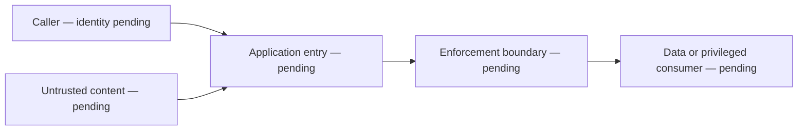

# Intake template — preparation v1

Status: pending. Replace placeholders only with engineer-supplied information. Store filled private
intakes outside version control; use anonymized identities and sanitized evidence in shared reports.

## Identity, host and scope

| Field | Value / named gap | Owner and next action |
|---|---|---|
| Assessment ID, date, assessor, engineer owner | Pending | Assign |
| Workflow revision and baseline review method/effort | Pending | Record commit and baseline |
| One non-MCP target alias, source revision and artifact identity | Pending | Engineer identifies target |
| Review host/product, version, OS and installation method | Pending | Engineer declares host |
| AI entry points, framework, provider/model settings if relevant | Pending | Inventory; unavailable internals stay Unknown |
| Source/configuration available and inaccessible components | Pending | Engineer supplies permitted access |
| Permitted read-only paths/artifact references and exclusions | Pending | Engineer defines scope |
| Identities, roles/tenants, data classes and privileged actions | Pending | Describe with synthetic names |
| Engineer review questions and expected security requirements | Pending | Supply application-specific expectations |
| Evidence storage, sharing/redaction rules and retention owner | Pending | Name access-controlled location |

Runtime execution is excluded from this intake. Any later runtime work needs its own declared
permitted actions, destinations, identities/data and budgets, plus verified containment. Source access
does not authorize execution, provider calls, spending, publication or protected-policy changes.

## Artifact inventory

| Evidence ID | Private locator / sanitized shareable locator | Revision, representation, digest if available | Collector, method, date | Who can alter it / trust limitation | Access gap and next step |
|---|---|---|---|---|---|
| E-01 | Pending | Pending | Pending | Target assertion, assessor observation, or independent corroboration? | Assign owner |

Record line/section selectors for source, relevant configuration and collection conditions. Verify
that the intended reviewer can resolve each pointer under permitted access. Do not reconstruct
provenance absent from an older artifact. A hash binds bytes, not execution or trustworthy collection.

## Trust boundaries

List components, identities, data/action flows, enforcement points and who can modify each surface.
Replace the scaffold with one diagram of the actual target before selecting checks.

This is a scaffold, not a finding or a verified architecture. Identify where model/provider access
occurs and which information is only asserted by the target owner.

## Readiness and engineer handoff

- Decision: pending / ready (with rationale and engineer agreement).
- Missing prerequisites: target/revision, host/version, scope, boundaries, artifact access, questions.
- Named owner and next action for each gap:
- Exactly three proposed checks, only after readiness: IDs, boundaries, expected behavior, applicable
  requirements and exact pinned standards versions/sections; explain selection from this target.
- Engineer corrections: original assertion, corrected fact, evidence and resulting scope/check change.
- Assessor/engineer, date, agreed scope revision and next bounded action:

No target-specific control can pass because this form is complete. Continue with
[report.md](report.md) only with the evidence and applicability that are actually available.
